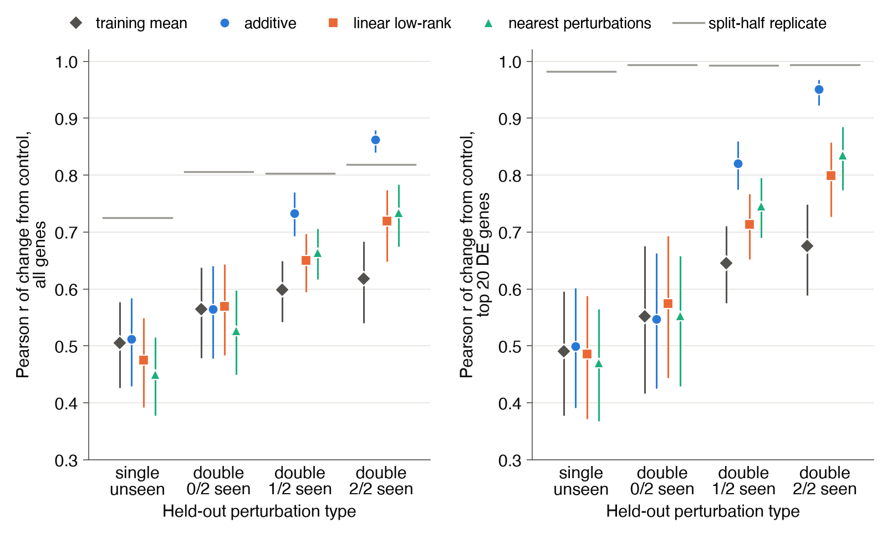
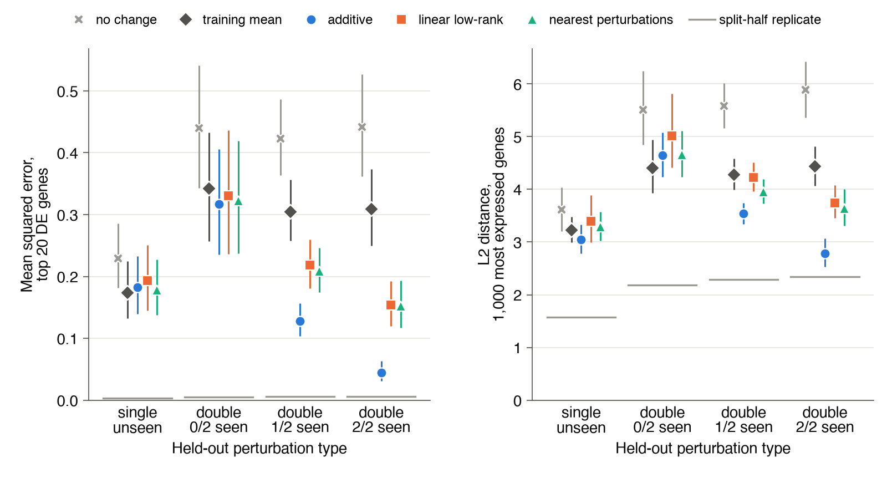
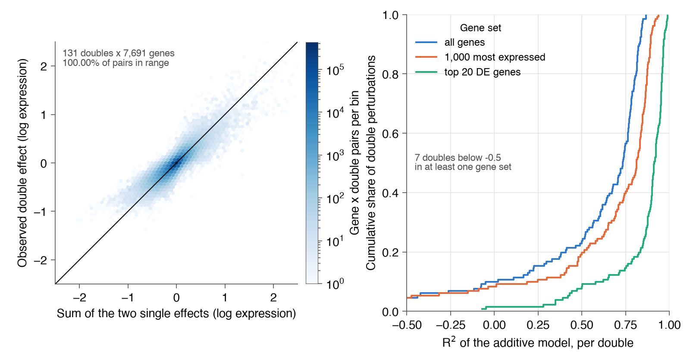
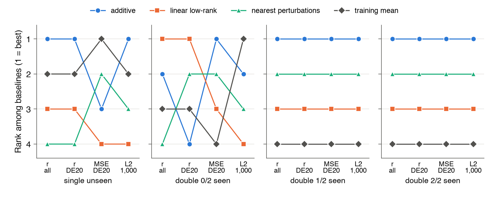

# perturbation-baseline-gate

A baseline gate for models that predict the transcriptional response of a cell to a
genetic perturbation. The repository measures how well five simple predictors (no change,
training mean, additive, linear low-rank, nearest perturbations) predict held-out single
and double perturbations of the Norman et al. 2019 Perturb-seq dataset, and provides a
function and a command that take the predictions of any model for the same held-out
perturbations and report, per metric, whether the model beats every baseline with a
paired bootstrap interval that excludes zero. It supplies the computation for a
literature-based model-selection study. All results are computed from a 4.8 MB file of
condition-level pseudobulk profiles that is shipped with the code, so everything runs
offline in a few minutes on a laptop.



*Mean and 95% interval over 20 random splits. Grey line: split-half replicate (one half
of a perturbation's cells scored as a prediction of the other half). Source:
`results/baseline_summary.csv`, `results/splithalf_summary.csv`.*

## Install

Python 3.10 or later.

```bash
git clone https://github.com/OdurShi/perturbation-baseline-gate.git perturbation-baseline-gate
cd perturbation-baseline-gate
python -m venv .venv && source .venv/bin/activate
pip install -e ".[dev]"        # add ",data" to rebuild the pseudobulk file from raw counts
```

The package reads the pseudobulk file from `data/` of the checkout, so install it in
editable mode as shown (or set `PBGATE_DATA` to the path of the `.npz` file).

## Quick start

```bash
pbgate info                                   # what is in the shipped pseudobulk file
pbgate baselines --seeds 0-4 --n-boot 2000    # baselines on five random splits

# the gate, with the additive baseline standing in for a model
pbgate export-split --seed 0 --out split0.json
pbgate predict --predictor additive --split split0.json --out additive0.npz
pbgate gate --pred additive0.npz --split split0.json
```

The last command prints one line per split category and metric and ends with
`gate: FAIL`, because a baseline cannot beat itself.

## Data

Norman et al. 2019: Perturb-seq of K562 cells with CRISPR activation of single genes and
gene pairs. The raw counts are taken from the scPerturb release on Zenodo
(<https://zenodo.org/records/13350497>, file `NormanWeissman2019_filtered.h5ad`,
698,680,199 bytes, CC BY 4.0). After filtering, the data comprise 91,168 cells
(9,702 control cells), 7,693 genes, 105 single and 131 double perturbations.

The repository ships only the derived pseudobulk file `data/norman2019_pseudobulk.npz`
(mean log-normalised expression per perturbation and for control cells, cell counts,
ranks of differentially expressed genes). `data/README.md` gives the source, licence,
processing steps and checksums. `scripts/download_data.py` and
`scripts/preprocess_pseudobulk.py` rebuild it from the raw file.

## Reproducing the results

| Item | Command | Output |
|---|---|---|
| Everything below, offline | `python scripts/run_all.py` | `results/`, `figures/`, `results/runtime.json` |
| Everything, starting from the raw counts | `python scripts/run_all.py --from-raw` | also `data/`, `results/sensitivity_all_cells.csv`, `results/runtime_from_raw.json` |
| Raw data (about 700 MB, cached, checksum verified) | `python scripts/download_data.py` | `data/raw/` or `$PBGATE_CACHE` |
| Pseudobulk file | `python scripts/preprocess_pseudobulk.py` | `data/norman2019_pseudobulk.npz`, `data/norman2019_conditions.csv` |
| Baselines on 20 splits, intervals, pairwise tests, split-half reference | `python scripts/run_baselines.py` | `results/splits.csv`, `baseline_records.csv`, `baseline_summary.csv`, `baseline_pairwise.csv`, `splithalf_summary.csv` |
| Variance explained by the additive model | `python scripts/analyze_additivity.py` | `results/additivity_per_double.csv`, `additivity_summary.json` |
| Ranking of baselines across metrics, overlap of DE gene sets | `python scripts/analyze_ranking.py` | `results/ranking_ranks.csv`, `ranking_comparison.csv`, `de_gene_frequency.csv` |
| Sensitivity to definitions and fixed settings | `python scripts/analyze_sensitivity.py` | `results/sensitivity.csv`, `sensitivity_additivity.json` |
| Gate applied to each baseline and to three synthetic candidates | `python scripts/gate_demo.py` | `results/gate_demo.csv`, `gate_demo.json` |
| Numbers behind the review of the first pass | `python scripts/review_checks.py` | `results/review_checks.json` |
| Figures | `python scripts/make_figures.py` | `figures/*.png` |
| Optional GEARS run (separate environment, raw data, not part of `run_all.py`) | `PYTHONPATH=scripts python scripts/optional_gears.py --work-dir gears_work --seed 0 --epochs 3` | predictions for `pbgate gate`; the shipped run is in `results/optional_gears/` |
| Tests and lint | `pytest` and `ruff check .` | |

Seeds are fixed (splits: seeds 0 to 19; bootstrap: seed 0), so the files are reproduced
exactly on the same platform.

## Definitions

Full definitions are in `docs/notes.md`; the short version:

- **Expression.** Counts per cell scaled to 10,000 and log(1 + x) transformed; a profile
  is the mean over the cells of one perturbation. The control profile is the mean over
  the cells with two non-targeting guides.
- **Splits** (convention of GEARS, Roohani et al. 2024). Per seed, 25% of the 105
  perturbed genes are declared unseen. Every perturbation that involves an unseen gene is
  held out; of the doubles with two seen genes, 25% are held out. Held-out perturbations
  are labelled *single, unseen gene* and *double with 0, 1 or 2 of 2 genes seen in
  training*. A draw with fewer than five perturbations in a category is redrawn.
- **Predictors**, all fitted on the control profile and the training perturbations only:
  `no_change` (control profile); `train_mean` (mean profile of the training
  perturbations); `additive` (control + sum of the single-gene effects; the mean effect
  of the training singles replaces the effect of a gene without a training single);
  `linear` (low-rank bilinear model in the spirit of Ahlmann-Eltze et al. 2025: gene
  embedding from a 10-component PCA of the training pseudobulk, perturbation embedding =
  sum of the gene-embedding rows of the perturbed genes, ridge penalty 0.1); `knn` (mean
  profile of the 5 training perturbations nearest in that embedding space).
- **Metrics**, on the change from control, per held-out perturbation: Pearson correlation
  over all genes (`pearson_all`); Pearson correlation over the 20 most differentially
  expressed genes (`pearson_de20`); mean squared error on those 20 genes (`mse_de20`);
  L2 distance over the 1,000 genes with the highest control expression (`l2_top1000`).
  The perturbed genes themselves are left out of all gene sets.
- **Intervals.** Means are over all (seed, perturbation) records of a category; 95%
  percentile intervals come from 10,000 bootstrap resamples of seeds and of perturbations.

## Results

All numbers are means over (seed, perturbation) records with 95% intervals in brackets.
Twenty seeds give 520 records for held-out singles (105 distinct perturbations), 189 for
doubles with 0/2 genes seen (101), 1,036 for 1/2 seen (131) and 348 for 2/2 seen (127);
see the columns `n_records` and `n_perturbations` of `results/baseline_summary.csv`.

### Baselines on held-out perturbations

Source of the four tables: `results/baseline_summary.csv`; last row of each:
`results/splithalf_summary.csv`. `no_change` has no defined correlation (constant
prediction) and is omitted from the first two tables.

Pearson correlation of the change from control, all genes (`pearson_all`, higher is better):

| Predictor | single, unseen gene | double, 0/2 seen | double, 1/2 seen | double, 2/2 seen |
|---|---|---|---|---|
| `train_mean` | 0.505 [0.427, 0.577] | 0.565 [0.479, 0.638] | 0.599 [0.542, 0.649] | 0.618 [0.540, 0.683] |
| `additive` | 0.512 [0.430, 0.584] | 0.565 [0.478, 0.641] | 0.733 [0.693, 0.770] | 0.862 [0.840, 0.879] |
| `linear` | 0.475 [0.392, 0.549] | 0.570 [0.484, 0.643] | 0.650 [0.594, 0.697] | 0.719 [0.649, 0.774] |
| `knn` | 0.450 [0.378, 0.515] | 0.527 [0.450, 0.598] | 0.664 [0.617, 0.706] | 0.734 [0.675, 0.783] |
| split-half replicate | 0.725 [0.677, 0.772] | 0.806 [0.753, 0.845] | 0.803 [0.772, 0.829] | 0.818 [0.789, 0.842] |

Pearson correlation of the change from control, top 20 DE genes (`pearson_de20`, higher is better):

| Predictor | single, unseen gene | double, 0/2 seen | double, 1/2 seen | double, 2/2 seen |
|---|---|---|---|---|
| `train_mean` | 0.491 [0.378, 0.595] | 0.552 [0.416, 0.676] | 0.645 [0.575, 0.710] | 0.676 [0.589, 0.748] |
| `additive` | 0.499 [0.391, 0.601] | 0.547 [0.425, 0.663] | 0.821 [0.775, 0.860] | 0.951 [0.923, 0.968] |
| `linear` | 0.486 [0.372, 0.588] | 0.575 [0.444, 0.693] | 0.713 [0.652, 0.767] | 0.799 [0.727, 0.857] |
| `knn` | 0.470 [0.368, 0.565] | 0.553 [0.429, 0.658] | 0.746 [0.690, 0.795] | 0.835 [0.774, 0.884] |
| split-half replicate | 0.982 [0.972, 0.989] | 0.994 [0.992, 0.995] | 0.993 [0.992, 0.994] | 0.994 [0.992, 0.995] |

Mean squared error, top 20 DE genes (`mse_de20`, lower is better):

| Predictor | single, unseen gene | double, 0/2 seen | double, 1/2 seen | double, 2/2 seen |
|---|---|---|---|---|
| `no_change` | 0.230 [0.182, 0.286] | 0.440 [0.343, 0.541] | 0.423 [0.364, 0.486] | 0.442 [0.362, 0.527] |
| `train_mean` | 0.174 [0.132, 0.224] | 0.342 [0.257, 0.432] | 0.305 [0.257, 0.357] | 0.309 [0.250, 0.374] |
| `additive` | 0.183 [0.140, 0.233] | 0.317 [0.235, 0.406] | 0.128 [0.104, 0.156] | 0.044 [0.031, 0.064] |
| `linear` | 0.194 [0.145, 0.251] | 0.330 [0.237, 0.436] | 0.218 [0.180, 0.259] | 0.154 [0.119, 0.192] |
| `knn` | 0.178 [0.137, 0.227] | 0.322 [0.237, 0.419] | 0.209 [0.174, 0.246] | 0.152 [0.117, 0.193] |
| split-half replicate | 0.003 [0.002, 0.004] | 0.005 [0.004, 0.007] | 0.006 [0.005, 0.007] | 0.006 [0.004, 0.007] |

L2 distance, 1,000 most expressed genes (`l2_top1000`, lower is better):

| Predictor | single, unseen gene | double, 0/2 seen | double, 1/2 seen | double, 2/2 seen |
|---|---|---|---|---|
| `no_change` | 3.61 [3.21, 4.04] | 5.51 [4.85, 6.25] | 5.58 [5.16, 6.01] | 5.89 [5.36, 6.42] |
| `train_mean` | 3.22 [3.00, 3.47] | 4.41 [3.94, 4.94] | 4.27 [3.99, 4.58] | 4.44 [4.07, 4.82] |
| `additive` | 3.05 [2.79, 3.33] | 4.65 [4.24, 5.07] | 3.54 [3.34, 3.75] | 2.78 [2.53, 3.07] |
| `linear` | 3.39 [2.99, 3.89] | 5.02 [4.42, 5.81] | 4.22 [3.96, 4.50] | 3.74 [3.46, 4.08] |
| `knn` | 3.29 [3.03, 3.57] | 4.66 [4.24, 5.11] | 3.95 [3.73, 4.19] | 3.63 [3.31, 4.01] |
| split-half replicate | 1.57 [1.46, 1.69] | 2.19 [1.92, 2.51] | 2.29 [2.11, 2.47] | 2.35 [2.12, 2.61] |



Paired comparisons between baselines (`results/baseline_pairwise.csv`, difference oriented
so that positive means the first predictor is better):

- **Unseen single genes.** The predictors that use perturbation-specific information do
  not beat the training mean. On `pearson_all` the training mean is better than `linear`
  by 0.030 [0.004, 0.063] and better than `knn` by 0.056 [0.033, 0.077]. On
  `pearson_de20` none of the six pairs of baselines differs. For a held-out single the
  additive predictor is itself a mean (control plus the mean effect of the training
  singles); it is better than `train_mean` by 0.006 [0.002, 0.011] on `pearson_all` and
  worse by 0.009 [0.003, 0.015] on `mse_de20`.
- **Doubles, 0/2 seen.** `train_mean`, `additive` and `linear` are indistinguishable on
  both correlations (for example `train_mean` minus `linear` on `pearson_all`:
  -0.005 [-0.039, 0.025]).
- **Doubles, 1/2 and 2/2 seen.** `additive` is better than every other baseline on all
  four metrics; for 2/2 seen the margin over the next baseline (`knn`) is 0.128
  [0.083, 0.187] on `pearson_all` and 0.108 [0.069, 0.152] on `mse_de20`.
- `no_change` is never better than another baseline; in 4 of 64 comparisons the
  difference is not significant (`linear` and `knn` on error metrics for unseen singles,
  `linear` on `l2_top1000` for 0/2-seen doubles).

### How much of the double-perturbation effects is additive

For each of the 131 doubles the observed effect (double minus control) is compared with
the sum of the two single effects, using all data (the additive model has no fitted
parameter). R2 = 1 - (sum of squared residuals) / (sum of squared effects), pooled over
doubles and genes; intervals from a bootstrap over doubles. Source:
`results/additivity_summary.json`, per double `results/additivity_per_double.csv`.

| Gene set | Pooled R2 | Pooled R2, sampling noise removed | Median R2 per double (quartiles) | Doubles with R2 < 0.5 | Median slope |
|---|---|---|---|---|---|
| all genes | 0.675 [0.632, 0.712] | 0.801 [0.759, 0.839] | 0.735 (0.518, 0.796) | 23.7% | 0.82 |
| 1,000 most expressed | 0.750 [0.709, 0.786] | 0.810 [0.769, 0.847] | 0.813 (0.620, 0.866) | 19.8% | 0.85 |
| top 20 DE genes | 0.898 [0.873, 0.918] | not computed | 0.915 (0.863, 0.956) | 8.4% | 0.93 |

- The additive model explains about two thirds of the sum of squares of the double
  effects over all genes and nine tenths over the top 20 DE genes.
- Sampling noise of the pseudobulk means accounts for 44% of the all-gene residual
  (`noise_share_of_residual`). With the expected noise subtracted from residual and
  total, the additive share is 0.80; about one fifth of the signal is not additive.
- Measured against the spread of the doubles around their mean effect instead of against
  zero, the additive share is 0.448 [0.376, 0.514] (0.639 [0.563, 0.707] with noise
  removed): much of what the additive model explains is shared by all doubles.
- The median slope of observed on additive effects is 0.82: double effects are on
  average smaller than the sum of the single effects.
- The model fails for a minority: 31 of 131 doubles have R2 below 0.5 over all genes,
  and the lowest value is -2.71.



### How the ranking of baselines depends on the metric

The four baselines with a defined correlation are ranked per split category under each
metric. Source: `results/ranking_ranks.csv`, `results/ranking_comparison.csv`
(`boot_p_same_best`: share of bootstrap resamples in which both metrics name the same
best baseline).

| Category | Order by `pearson_all` | Order by `pearson_de20` | Kendall tau | Same best baseline |
|---|---|---|---|---|
| single, unseen gene | additive > train_mean > linear > knn | additive > train_mean > linear > knn | 1.00 | 0.60 |
| double, 0/2 seen | linear > additive > train_mean > knn | linear > knn > train_mean > additive | 0.00 | 0.53 |
| double, 1/2 seen | additive > knn > linear > train_mean | additive > knn > linear > train_mean | 1.00 | 1.00 |
| double, 2/2 seen | additive > knn > linear > train_mean | additive > knn > linear > train_mean | 1.00 | 1.00 |

- When at least one gene of a double was seen, the order is the same under all four
  metrics (additive, knn, linear, training mean) and stable under resampling.
- For unseen singles and for doubles with no seen gene the baselines are within each
  other's intervals and the order is not stable: the two correlations name the same best
  baseline in only 60% and 53% of the resamples, and the error metrics order the
  baselines differently (for unseen singles `mse_de20` gives train_mean > knn > additive
  > linear, Kendall tau 0.00 against `pearson_all`; `l2_top1000` puts `train_mean` first
  for 0/2-seen doubles, tau -0.33).
- The top-20 DE sets overlap strongly between perturbations: 886 distinct genes fill the
  4,720 slots, and the five most frequent genes are each in the set of 39% to 50% of
  the perturbations (`results/de_gene_frequency.csv`). This is why a constant prediction
  reaches a correlation near 0.5 on them.



### Sensitivity

`results/sensitivity.csv` repeats the analysis with one definition or setting changed.
Keeping the perturbed genes in the gene sets (the conventional definition) changes
`pearson_all` by at most 0.007, lowers `pearson_de20` by up to 0.033 and raises
`mse_de20` by up to 0.036; the order of the baselines on 1/2- and 2/2-seen doubles is
unchanged under every metric. The linear model depends on its rank: with 40 components
it reaches `pearson_all` 0.797 on 2/2-seen doubles (0.719 with 10) and 0.447 on unseen
singles (0.475 with 10); with a very large ridge penalty it reduces to a mean prediction
(0.501 on unseen singles). On `pearson_all` no setting in the table brings it above the
additive model on seen doubles or above the two mean predictions on unseen singles.

### The gate applied to the baselines

`scripts/gate_demo.py` passes the predictions of each baseline for all 20 seeds through
the gate, tested against the other four baselines, and adds three synthetic candidates
tested against all five. The table gives the number of metrics (of 4) on which the
candidate beats every baseline it is tested against (`results/gate_demo.csv`).

| Candidate | single, unseen gene | double, 0/2 seen | double, 1/2 seen | double, 2/2 seen |
|---|---|---|---|---|
| `no_change` (against all five, itself included) | 0 | 0 | 0 | 0 |
| `train_mean` | 0 | 0 | 0 | 0 |
| `additive` | 2 | 0 | 4 | 4 |
| `linear` | 0 | 0 | 0 | 0 |
| `knn` | 0 | 0 | 0 | 0 |
| observed profile + noise (sd 0.05 per gene) | 4 | 4 | 4 | 3 |
| observed profile + noise (sd 0.005 per gene) | 4 | 4 | 4 | 4 |

- No baseline passes the gate. `additive` wins every comparison for doubles with at
  least one seen gene. For unseen singles it wins on `pearson_all` and `l2_top1000`,
  on `pearson_all` by a margin of 0.006 over `train_mean`: with about 100 perturbations
  the test detects differences that are of no practical size, so the reported advantage
  should be read together with the verdict (`--min-advantage` sets a larger margin).
- The observed profiles with independent noise of 0.05 log units per gene, a stand-in
  for a very accurate model, fail one comparison: on 2/2-seen doubles their `pearson_all`
  is 0.834, below the additive baseline (0.862).
- With noise of 0.005 the candidate passes everywhere and the gate prints its leakage
  warning, because the squared L2 error (0.025) is below the sampling noise of the
  observed profiles (0.67 to 1.65 per category, `results/gate_demo.json`).

### Optional: one deep model

GEARS (Roohani et al. 2024) was trained once with `scripts/optional_gears.py` on the
training perturbations of seed 0 and its predictions were passed through the gate. The
run is a reduced configuration: 3 epochs (the package default is 20), at most 60 cells
per perturbation and 1,000 control cells, CPU, 124 training and 13 validation
perturbations (`results/optional_gears/gears_seed0_run.json`). GEARS can predict 92 of
the 95 held-out perturbations; three involve a gene that is absent from its
gene-ontology graph.

| Metric (`results/optional_gears/gate_seed0.json`) | single, unseen gene (25) | double, 0/2 seen (5) | double, 1/2 seen (43) | double, 2/2 seen (19) |
|---|---|---|---|---|
| `pearson_all`, GEARS / strongest baseline | 0.327 / 0.487 | 0.370 / 0.460 | 0.543 / 0.705 | 0.472 / 0.850 |
| `pearson_de20` | 0.370 / 0.511 | 0.460 / 0.551 | 0.672 / 0.806 | 0.539 / 0.964 |
| `mse_de20` | 0.174 / 0.165 | 0.186 / 0.222 | 0.172 / 0.145 | 0.132 / 0.028 |
| `l2_top1000` | 3.76 / 3.32 | 5.04 / 5.07 | 4.57 / 3.91 | 3.91 / 2.41 |

In this configuration GEARS fails the gate in every category and metric; it beats
`no_change` in most comparisons and, on `mse_de20` for 1/2-seen doubles, all baselines
except `additive`. For the five 0/2-seen doubles its mean errors are lower than those of
the strongest baseline, with intervals that include zero. Its validation error was still falling when training stopped (top-20
DE error 0.212, 0.138, 0.127 after epochs 1 to 3,
`results/optional_gears/gears_seed0_training_log.txt`). The run shows that a deep model
can be put through the gate end to end; it is not a measurement of GEARS at its intended
training budget. The command
`pbgate gate --pred results/optional_gears/gears_seed0.npz --split results/optional_gears/split_seed0.json`
reproduces the table offline.

### Reading the results

What the numbers show:

- **Genes not seen in training.** For held-out singles and for doubles with no seen
  gene, the best simple prediction is a constant, the mean of the training
  perturbations. It reaches a correlation of 0.505 and 0.565 over all genes and of 0.491
  and 0.552 on the top 20 DE genes, because perturbations in this dataset share a large part
  of their response (one gene, HBZ, is among the top 20 DE genes of 118 of the 236
  perturbations, `results/de_gene_frequency.csv`). The two baselines that could make
  perturbation-specific predictions for an unseen gene, `linear` and `knn`, are not
  better and on `pearson_all` are worse. A correlation near 0.5 for an unseen gene
  therefore carries no perturbation-specific information on this dataset.
- **Doubles whose single genes were seen.** The additive prediction is close to
  replicate quality on the all-gene metrics (`pearson_all` 0.862 against 0.818 for the
  split-half replicate, which uses half the cells) and leaves room on the DE genes
  (`mse_de20` 0.044 against 0.006). About four fifths of the double-perturbation signal
  is additive after removing sampling noise; a model can gain over the additive baseline
  only on the remaining fifth.
- **Ranking.** Where the baselines carry perturbation-specific information, their order
  is the same under all four metrics. Where they do not, the order changes with the
  metric and with resampling, so a claim that one method is best for unseen genes needs
  more than one metric and an interval.
- **The gate works as a test.** It rejects each of the five baselines and accepts a
  prediction close to the observed profiles.

What they do not show:

- They do not measure any deep model at its published training budget. That deep models
  fail to beat such baselines is a finding of the cited literature (Ahlmann-Eltze et al.
  2025), which this repository does not re-test; the optional GEARS run above is a
  reduced configuration on one split.
- They concern one dataset: one cell line, CRISPR activation, 105 genes chosen by the
  original study, many of them with strong and shared effects.
- "Strong baseline" means different things in the two regimes. For seen doubles the
  additive baseline is near the noise limit. For unseen genes the baselines are far below
  the split-half replicate for held-out singles (best baseline 0.512 against 0.725 on
  `pearson_all`, 0.499 against 0.982 on `pearson_de20`): the data would support a better
  prediction, and the baselines mark
  the level reached without any knowledge of the perturbed gene.
- Passing the gate shows that a model is better than these baselines on these metrics
  and splits, by a margin that may be small; it does not show that the model is accurate
  enough for a given use.

## How to gate your own model

1. Export a split and train on its `train` list (plus control cells) only.

   ```bash
   pbgate export-split --seed 0 --out split0.json
   ```

2. Write the predicted profiles of the held-out perturbations (`test` list, or any
   subset of it) to a file. Values are predicted mean log-normalised expression (not
   changes from control) for all 7,693 genes of `data/norman2019_pseudobulk.npz`.
   - CSV: first column perturbation names (`KLF1`, `CBL+CNN1`; `KLF1+ctrl` is also
     accepted), one column per gene symbol.
   - NPZ: arrays `conditions` (n), `genes` (G), `pred` (n x G).

3. Run the gate. Repeat `--pred` and `--split` to pool several seeds.

   ```bash
   pbgate gate --pred my_model_seed0.csv --split split0.json --out gate_seed0.json
   ```

   For each split category and metric the command fits the five baselines on the same
   training perturbations, compares the model with each baseline on the same held-out
   perturbations, and bootstraps the mean paired difference (10,000 resamples of
   perturbations, and of seeds when several are given). A metric passes when the 95%
   interval of the model's advantage over every baseline lies above zero. The exit code
   is 0 only if every metric passes in every category for which predictions were given.

The same from Python:

```python
import pandas as pd
from pbgate.data import load_pseudobulk
from pbgate.gate import run_gate
from pbgate.leakage import check_predictor
from pbgate.splits import make_split

data = load_pseudobulk()
split = make_split(data.conditions.tolist(), seed=0)


def my_model(data, split):  # returns (len(split.test), n_genes)
    train = data.train_view(split.train)  # control + training perturbations only
    ...


check_predictor(my_model, data, split)  # raises LeakageError if held-out rows are read
pred = pd.DataFrame(my_model(data, split), index=split.test, columns=data.genes)
result = run_gate([(pred, split)], data)
print(result.verdict)  # one row per split category and metric
print(result.passed)
```

Safeguards: the gate refuses predictions for training perturbations, predictions that
reproduce the observed profiles, and splits in which train and test overlap or a gene
declared unseen occurs in training. It warns when the squared L2 error is below the
sampling noise of the observed profiles. `check_predictor` reruns a prediction function
on data whose held-out profiles are scrambled and reports any change in its output.
None of these checks can certify a prediction file that was produced elsewhere.

## Structure

```
src/pbgate/          package
  data.py            pseudobulk container, file I/O, checksums
  splits.py          splits over perturbations and their validation
  predictors.py      the five baselines
  metrics.py         the four metrics and their gene sets
  evaluate.py        fit, score, summarise over seeds
  stats.py           bootstrap over seeds and perturbations
  gate.py            the gate and prediction-file I/O
  leakage.py         leakage checks
  analysis.py        additivity, ranking, pairwise comparisons
  plotting.py        figure style
  cli.py             the `pbgate` command
scripts/             download, preprocessing, one script per analysis, run_all.py
data/                derived pseudobulk file, its README and checksums
results/             CSV and JSON written by the scripts; optional_gears/ holds the GEARS run
figures/             PNG written by scripts/make_figures.py
tests/               offline tests (pytest)
docs/notes.md        assumptions, exact definitions, what was run, runtimes
```

## Licence

MIT, copyright "The authors"; see `LICENSE`. The derived data in `data/` are distributed
under CC BY 4.0, the licence of their source.

## Data acknowledgement and references

The data were generated by Norman et al. and harmonised and redistributed by the
scPerturb project; the file used here is from the scPerturb Zenodo record. Please cite
both when using `data/norman2019_pseudobulk.npz`.

- Norman TM, Horlbeck MA, Replogle JM, Ge AY, Xu A, Jost M, Gilbert LA, Weissman JS.
  Exploring genetic interaction manifolds constructed from rich single-cell phenotypes.
  *Science* 365, 786-793 (2019). <https://doi.org/10.1126/science.aax4438>
- Peidli S, Green TD, Shen C, Gross T, Min J, Garda S, Yuan B, Schumacher LJ,
  Taylor-King JP, Marks DS, Luna A, Blüthgen N, Sander C. scPerturb: harmonized
  single-cell perturbation data. *Nature Methods* 21, 531-540 (2024).
  <https://doi.org/10.1038/s41592-023-02144-y>
- Ahlmann-Eltze C, Huber W, Anders S. Deep-learning-based gene perturbation effect
  prediction does not yet outperform simple linear baselines. *Nature Methods* 22,
  1657-1661 (2025). <https://doi.org/10.1038/s41592-025-02772-6>
- Roohani Y, Huang K, Leskovec J. Predicting transcriptional outcomes of novel multigene
  perturbations with GEARS. *Nature Biotechnology* 42, 927-935 (2024).
  <https://doi.org/10.1038/s41587-023-01905-6>

Pages opened while preparing this repository (14 November 2026): the Zenodo record
<https://zenodo.org/records/13350497>; the Europe PMC records of Norman et al. and of
Peidli et al.
(<https://www.ebi.ac.uk/europepmc/webservices/rest/search?query=EXT_ID:31395745%20AND%20SRC:MED&format=json&resultType=core>
and the same query with `EXT_ID:38279009`); the full text of
Ahlmann-Eltze et al. at
<https://www.ebi.ac.uk/europepmc/webservices/rest/PMC12328236/fullTextXML> (definitions
of the linear model, of the Pearson correlation of changes from control and of the L2
distance over the 1,000 most expressed genes); the full text of Roohani et al. at
<https://pmc.ncbi.nlm.nih.gov/articles/PMC11180609/> (held-out categories by number of
seen genes, error on the 20 most differentially expressed genes).
